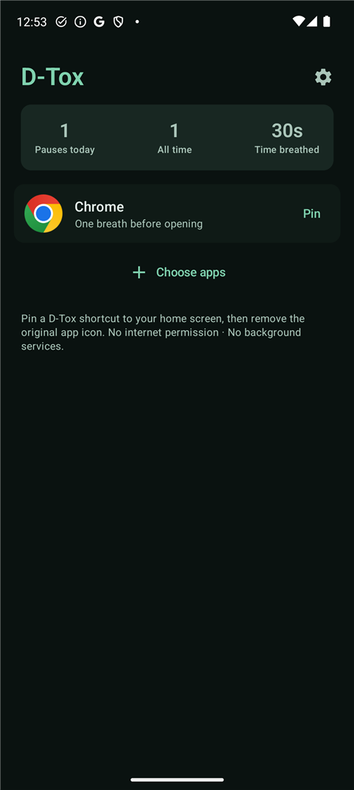
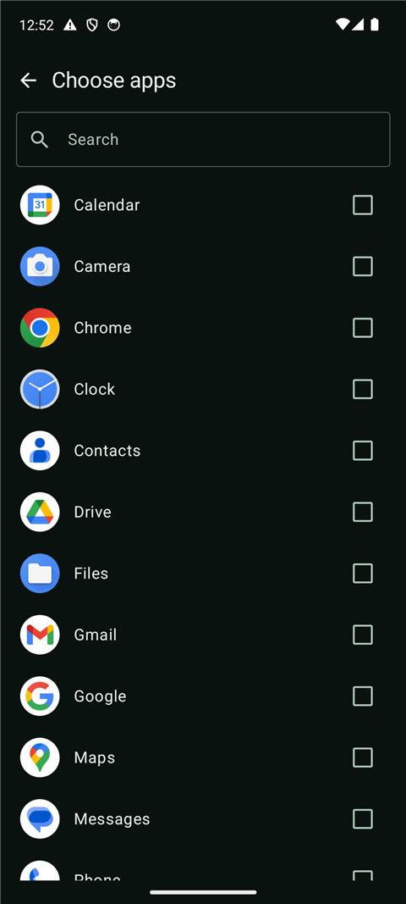
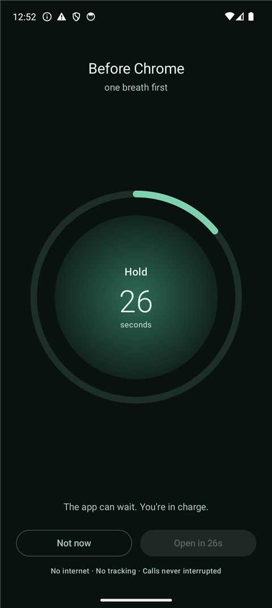
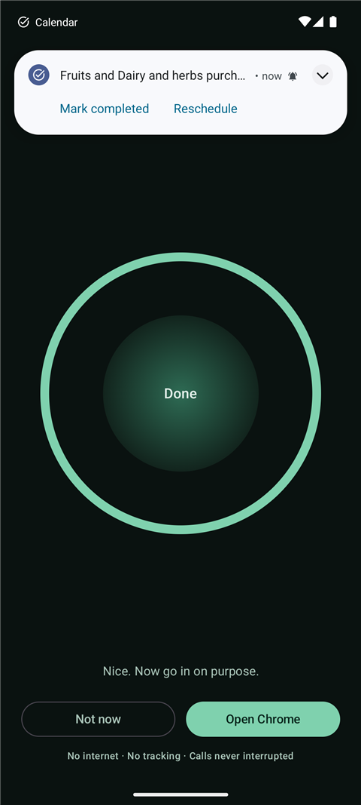
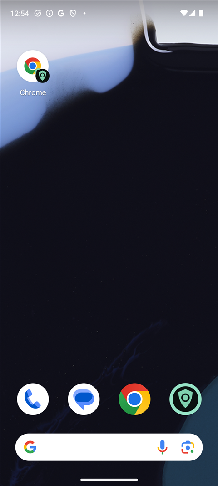

<div align="center">

# D-Tox

**One quiet breath before the app opens.**

D-Tox is a tiny, calm Android app that turns opening a distracting app into a
30-second guided breathing pause. Built to be the opposite of the usual
"detox" apps: no bloat, no ads, no account, no subscription — and **zero
Android permissions**.

[](https://github.com/coder5omkar/D-Tox/releases/latest)
[](https://github.com/coder5omkar/D-Tox/releases)


[](LICENSE)


&nbsp;&nbsp;&nbsp;

</div>

---

## What it does

Tap the D-Tox shortcut for a distracting app (or a tile inside D-Tox) and you
get a 30-second guided breathing pause — an animated ring with inhale / hold /
exhale phases — before the app can open. The **Open** button stays locked
until the breath is finished.

## Why D-Tox is different

| | Typical detox app | **D-Tox** |
| --- | --- | --- |
| Size | 30–150 MB | **1.2 MB** |
| Price | Subscription | **Free (GPL-3.0)** |
| Android permissions | Accessibility, usage access, network… | **None** |
| Internet | Ads, analytics, accounts | **No `INTERNET` permission at all** |
| Background | Always-on services | **Nothing runs when it's closed** |

Because D-Tox has no internet permission, nothing about your usage can leave
the phone. There is no account, no telemetry, no crash reporter — the entire
app state is one local `SharedPreferences` file.

## How the gate works

Android doesn't let a normal app know when you launch another app — that is
why almost every blocker asks for the Accessibility permission. D-Tox flips
the model: **D-Tox becomes the entry point.**

1. Pick the apps you want to slow down (Instagram, YouTube, X, TikTok…).
2. Tap **Pin** and add the badge shortcut to your home screen — the app's own
   icon with a small green ring.
3. Remove the original icons from your home screen.
4. From then on you open those apps *through D-Tox*: 30-second breath first.



That is the whole trick: zero permissions, zero battery cost, and nothing to
bypass unless you go hunting through the app drawer, recents or settings.
(Android keeps those last few doors open for any normal app.)

### Phone calls are never touched

D-Tox has no background components, so it cannot interfere with incoming or
outgoing calls. If a call arrives mid-breath, the timer pauses itself and
resumes right where it stopped when you are back.

## Install

**From this repo (recommended):** download `app-release.apk` from the
[latest release](https://github.com/coder5omkar/D-Tox/releases/latest) and tap
it on your phone. If Android asks, allow "Install unknown apps" for your
browser or file manager.

**From source:**

```
gradlew.bat assembleDebug      # debug build
gradlew.bat assembleRelease    # minified release build
```

Requirements: Android Studio (recent) or a terminal with JDK 17–21. The build
automatically uses Android Studio's bundled JDK (see `gradle.properties`).

## First-run setup

1. Open D-Tox → **Choose apps** → tick the apps that pull you in.
2. Back home → tap **Pin** on each → "Add to home screen" in the system dialog.
3. Long-press the original app icons → **Remove**.
4. Done — the badge shortcut now leads with a breath.

Tip: hide the app from your launcher's app drawer too — Samsung One UI:
*Home screen settings → Hide apps*; MIUI/HyperOS: *Settings → Home screen →
Hide apps*; most third-party launchers have a similar option. Then the badge
shortcut is the only easy way in.

## Features

- 30-second breathing gate, configurable **15–60 s**
- Two patterns: **Box 4·4·4·4** and **Calm 4·7·8**
- Animated breathing ring with phase countdown, haptic ticks
- Home-screen badge shortcuts, pinned straight from the app
- **Open** locked until the breath completes (optional early-open switch)
- Local stats: pauses today · all time · total time breathed
- Dark, calm Material 3 theme — quiet by design

## Project layout

```
app/src/main/java/com/dtox/app/
├── MainActivity.kt          single activity; receives gate requests
├── data/
│   ├── Apps.kt              lists launcher apps (permission-free)
│   ├── BreathPattern.kt     breathing phases, plain arithmetic
│   └── Prefs.kt             SharedPreferences: gated apps, settings, stats
├── ui/
│   ├── DToxRoot.kt          tiny state-based navigation
│   ├── HomeScreen.kt        gated apps + stats
│   ├── PickerScreen.kt      searchable app picker
│   ├── SettingsScreen.kt    breath length, pattern, haptics
│   ├── BreathScreen.kt      the 30-second gate (call-safe timer)
│   └── DToxIcons.kt         hand-rolled icons, no extra dependency
└── util/
    ├── ContextExt.kt
    └── Shortcuts.kt         pins the badge shortcuts
```

## Roadmap

- **v1.1 (planned): "Hidden mode"** — optional integration with
  [Shizuku](https://shizuku.rikka.app/) that truly hides gated apps from the
  drawer, search and recents, and unhides them only for the breath-then-launch
  flow. D-Tox itself would still declare zero Android permissions.
- Accessibility "Shield" mode for a single-app alternative.
- Sound cues, home-screen widget, streaks, custom patterns.

## Build details

- Kotlin 2.4.21 · Jetpack Compose (BOM 2026.09) · Material 3
- AGP 9.4.1 (built-in Kotlin) · Gradle 9.8.1
- `minSdk 26` (Android 8.0) · `compileSdk 37` · `targetSdk 37`
- Release build: R8 + resource shrinking → ~1.2 MB APK

### Signing a release build

`keystore.properties` in the repo root (git-ignored):

```
storeFile=keystore/dtox-release.jks
storePassword=…
keyAlias=dtox
keyPassword=…
```

With that file present, `gradlew assembleRelease` produces a signed
`app-release.apk`.

## License

[GPL-3.0](LICENSE) — free to use, study, share and improve. Derivative works
stay open source too.
