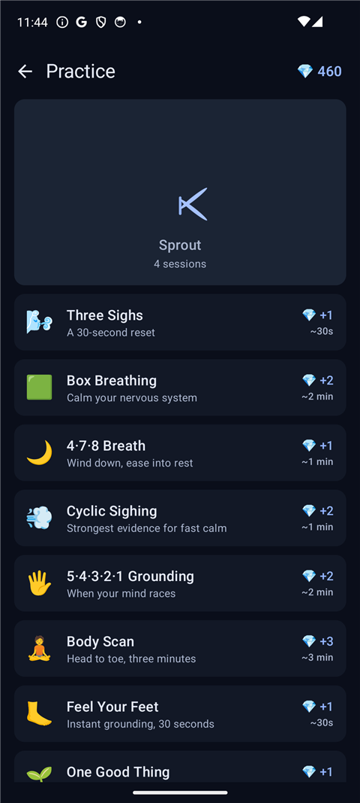
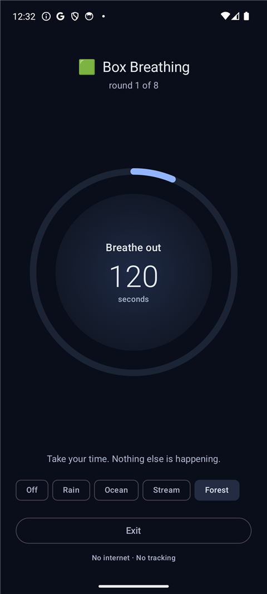
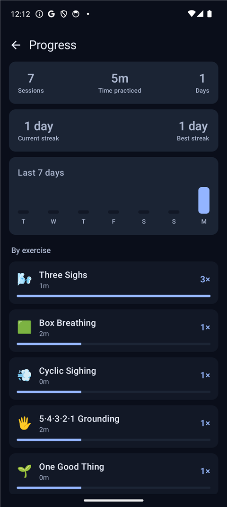
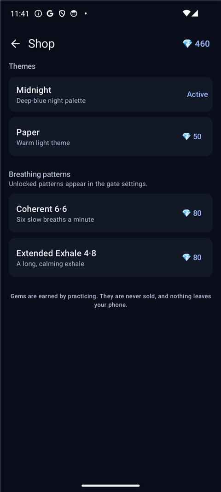

<div align="center">

# D-Tox

**One quiet breath before the app opens.**

D-Tox is a tiny, calm Android app with two sides: it turns opening a
distracting app into a 30-second breathing pause, **and** it gives you a
quiet practice space — eight evidence-informed exercises, a plant that grows
with you, and gems you earn (never buy). No bloat, no ads, no account, no
subscription — and **zero Android permissions**.

[](https://github.com/coder5omkar/D-Tox/releases/latest)
[](https://github.com/coder5omkar/D-Tox/releases)


[](LICENSE)


&nbsp;&nbsp;&nbsp;

&nbsp;&nbsp;&nbsp;

</div>

---

## What it does

Tap the D-Tox shortcut for a distracting app (or a tile inside D-Tox) and you
get a 30-second guided breathing pause — an animated ring with inhale / hold /
exhale phases — before the app can open. The **Open** button stays locked
until the breath is finished.

### Practice — the other half

Open **Practice** from the front screen for a small, self-contained
mindfulness space:

- **8 exercises** — Box Breathing, 4·7·8, Cyclic Sighing, Three Sighs,
  5·4·3·2·1 Grounding, Body Scan, Feel Your Feet, One Good Thing
- **Mood check-ins** before and after — if your mood lifts, +1 bonus gem
- **Gems** earned by practicing, never sold (1–3 per exercise plus bonuses)
- **Streaks** with one grace day, so a single missed day doesn't wipe it
- **A plant that grows with you** — one stage for every milestone
  (1, 5, 15, 30, 60, 100, 200 sessions), drawn entirely in code. It never
  dies; it only dims a little when you're away.
- **Progress page** — sessions, total time practiced, days, current and best
  streak, a 7-day chart and a per-exercise breakdown
- **Calming sounds** — rain, ocean, stream and forest-with-birds, played
  during exercises. These are **real field recordings** (CC0 / CC BY), trimmed
  into seamless loops and loudness-normalised; full credits in
  [LICENSES.md](LICENSES.md). No downloads, no permissions — the recordings
  ship inside the app. Sound fades in, pauses for phone calls and stops when
  you're done.
- **Shop** — spend gems on two extra themes (Midnight, Paper) and two rare
  breathing patterns (Coherent 6·6, Extended Exhale 4·8)
- **Zen mode** — hide gems, streaks and the plant; just exercises
- **The science** — a plain-language page with the actual studies behind the
  exercises, and honest caveats

The front screen shows **both sides at a glance** — gate stats and practice
stats side by side in equal cards, plus your plant's current stage.

## Why D-Tox is different

| | Typical detox app | **D-Tox** |
| --- | --- | --- |
| Size | 30–150 MB | **2.5 MB** |
| Price | Subscription | **Free (GPL-3.0)** |
| Android permissions | Accessibility, usage access, network… | **None** |
| Internet | Ads, analytics, accounts | **No `INTERNET` permission at all** |
| Background | Always-on services | **Nothing runs when it's closed** |

Because D-Tox has no internet permission, nothing about your usage can leave
the phone. There is no account, no telemetry, no crash reporter — the entire
app state is one local `SharedPreferences` file.

## How the gate works

Android doesn't let a normal app know when you launch another app — that is
why almost every blocker asks for the Accessibility permission. D-Tox flips
the model: **D-Tox becomes the entry point.**

1. Pick the apps you want to slow down (Instagram, YouTube, X, TikTok…).
2. Tap **Pin** and add the badge shortcut to your home screen — the app's own
   icon with a small green ring.
3. Remove the original icons from your home screen.
4. From then on you open those apps *through D-Tox*: 30-second breath first.


That is the whole trick: zero permissions, zero battery cost, and nothing to
bypass unless you go hunting through the app drawer, recents or settings.
(Android keeps those last few doors open for any normal app.)

### Phone calls are never touched

D-Tox has no background components, so it cannot interfere with incoming or
outgoing calls. If a call arrives mid-breath, the timer pauses itself and
resumes right where it stopped when you are back.

## Install

**From this repo (recommended):** download `app-release.apk` from the
[latest release](https://github.com/coder5omkar/D-Tox/releases/latest) and tap
it on your phone. If Android asks, allow "Install unknown apps" for your
browser or file manager.

**From source:**

```
gradlew.bat assembleDebug      # debug build
gradlew.bat assembleRelease    # minified release build
```

Requirements: Android Studio (recent) or a terminal with JDK 17–21. The build
automatically uses Android Studio's bundled JDK (see `gradle.properties`).

## First-run setup

1. Open D-Tox → **Choose apps** → tick the apps that pull you in.
2. Back home → tap **Pin** on each → "Add to home screen" in the system dialog.
3. Long-press the original app icons → **Remove**.
4. Done — the badge shortcut now leads with a breath.

Tip: hide the app from your launcher's app drawer too — Samsung One UI:
*Home screen settings → Hide apps*; MIUI/HyperOS: *Settings → Home screen →
Hide apps*; most third-party launchers have a similar option. Then the badge
shortcut is the only easy way in.

## Features

**The gate**

- 30-second breathing gate, configurable **15–60 s**
- Patterns: **Box 4·4·4·4**, **Calm 4·7·8**, **Sigh 3·1·6** (+ 2 unlockables)
- Animated breathing ring with phase countdown, haptic ticks
- Home-screen badge shortcuts, pinned straight from the app
- **Open** locked until the breath completes (optional early-open switch)
- Local stats: pauses today · all time · total time breathed

**The practice**

- 8 guided exercises — breathing and step-by-step grounding, body and
  gratitude practices
- Mood check-ins with a small bonus when you feel better afterwards
- Gems, streaks with a grace day, and a plant that grows across 8 stages
- **Progress page** — totals, streaks, a 7-day chart and a per-exercise
  breakdown with time practiced
- Shop with themes and extra breathing patterns — gems only, never money
- Calming ambient sounds (rain, ocean, stream, forest) — real recordings,
  seamless loops, credited in LICENSES.md
- Zen mode for a pure, reward-free practice
- "The science" page with the real citations, and honest caveats

**The front screen**

- Gate stats and Practice stats in two equal cards, side by side
- One line explains what the plant is and how it grows

**The fundamentals**

- Zero permissions, no internet, no accounts, no ads
- Three calm Material 3 themes (Forest free; Midnight and Paper unlockable)
- Everything stored locally in one `SharedPreferences` file

## Project layout

```
app/src/main/java/com/dtox/app/
├── MainActivity.kt          single activity; receives gate requests
├── data/
│   ├── Apps.kt              lists launcher apps (permission-free)
│   ├── BreathPattern.kt     breathing phases, incl. unlockable patterns
│   ├── Exercise.kt          the 8-exercise catalog
│   ├── PracticeStore.kt     gems, streaks, sessions, unlocks, Zen mode
│   ├── Prefs.kt             gate settings + gate stats
│   └── Shop.kt              shop catalog
├── ui/
│   ├── DToxRoot.kt          tiny state navigation + theme wiring
│   ├── HomeScreen.kt        gated apps + stats (the gate side)
│   ├── PickerScreen.kt      searchable app picker
│   ├── SettingsScreen.kt    gate settings, Zen mode
│   ├── BreathScreen.kt      the 30-second gate (call-safe timer)
│   ├── ScienceScreen.kt     the research, in plain language
│   ├── DToxIcons.kt         hand-rolled icons, no extra dependency
│   ├── breath/
│   │   └── BreathCommon.kt  shared breathing ring + phase helpers
│   ├── practice/
│   │   ├── PracticeHomeScreen.kt
│   │   ├── ExercisePlayerScreen.kt   player, mood checks, completion
│   │   ├── PlantView.kt     the plant, drawn in code — no image assets
│   │   └── ShopScreen.kt
│   └── theme/Theme.kt       Forest / Midnight / Paper
└── util/
    ├── ContextExt.kt
    └── Shortcuts.kt         pins the badge shortcuts
```

## Roadmap

- **"Hidden mode" (planned)** — optional integration with
  [Shizuku](https://shizuku.rikka.app/) that truly hides gated apps from the
  drawer, search and recents, and unhides them only for the breath-then-launch
  flow. D-Tox itself would still declare zero Android permissions.
- Accessibility "Shield" mode for a single-app alternative.
- Ambient sounds, home-screen widget, custom breathing patterns, manual
  backup/export.

## Build details

- Kotlin 2.4.21 · Jetpack Compose (BOM 2026.09) · Material 3
- AGP 9.4.1 (built-in Kotlin) · Gradle 9.8.1
- `minSdk 26` (Android 8.0) · `compileSdk 37` · `targetSdk 37`
- Release build: R8 + resource shrinking → ~2.5 MB APK (practice module code
  ~50 KB; the four recorded ambience loops ~1.1 MB)

### Signing a release build

`keystore.properties` in the repo root (git-ignored):

```
storeFile=keystore/dtox-release.jks
storePassword=…
keyAlias=dtox
keyPassword=…
```

With that file present, `gradlew assembleRelease` produces a signed
`app-release.apk`.

## Made by

**coder5omkar** — [github.com/coder5omkar](https://github.com/coder5omkar)

D-Tox is free and open source (GPL-3.0). You'll also find this card at the
bottom of the Progress page in the app.

## License

[GPL-3.0](LICENSE) — free to use, study, share and improve. Derivative works
stay open source too. Third-party assets (the ambient recordings) are
credited in [LICENSES.md](LICENSES.md).
